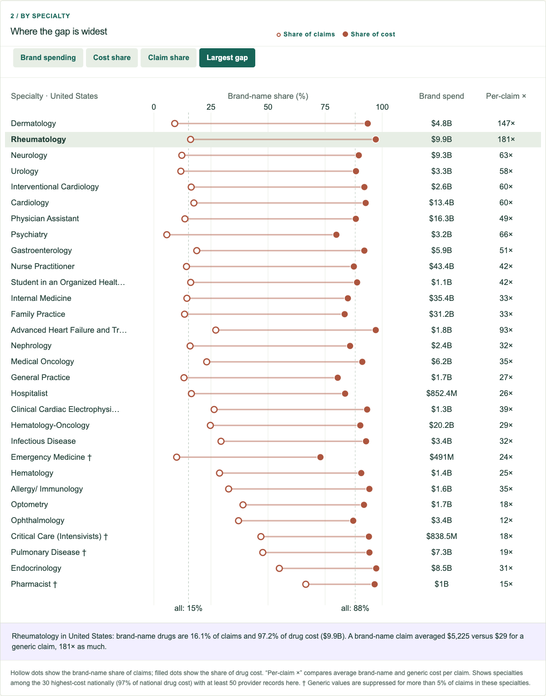
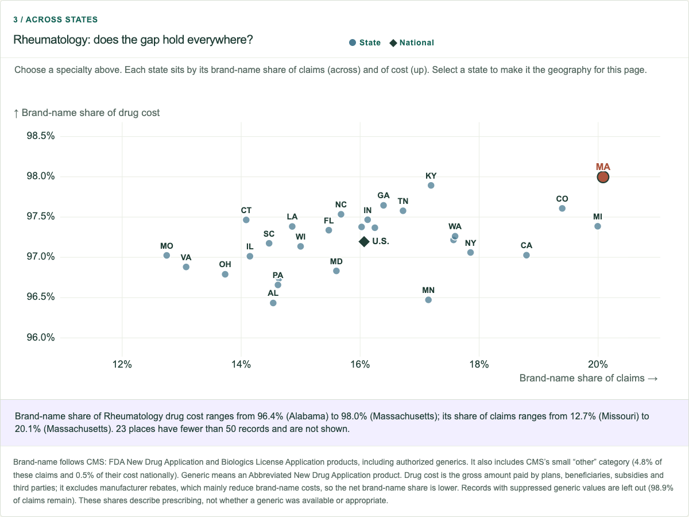

# Week 08 — Iterate your Project: brand-name and generic drugs

A new question for the explorer: **generic drugs fill most Part D prescriptions, so where does the money go?**

[Hosted Week 8 entry](https://sd7777777.github.io/data-visualization-student-starter/#week-8) · [Project document](../../../docs/PROJECT_DIRECTION.md) · [Entry source](BrandGap.tsx)

Week 8 iteration · October 13, 2026.

## What changed

Until now the explorer treated a claim as a claim. The CMS file splits every prescriber's claims and cost into brand-name, generic and "other" drugs, but earlier versions never used those fields. Week 8 adds them through a new preprocessing step and a three-part view on the main page:

1. **The flip.** Two 100% bars show the same prescriptions counted by claims and by drug cost. Nationally, brand-name drugs are 15.2% of claims and 88.2% of drug cost. An average brand-name claim cost $967, compared with $23 for a generic claim, 42 times as much.
2. **By specialty.** For each of the 30 highest-cost specialties, a hollow dot marks the brand-name share of claims and a filled dot marks its share of cost. Rows sort by brand spending, either share, or the size of the gap. Selecting a row carries that specialty through the rest of the page.
3. **Across states.** For the selected specialty, every state with at least 50 provider records is placed by its brand-name share of claims and of cost, with the national value as a reference. Selecting a state makes it the geography for the whole page.

The geography selector, the selected specialty, and the CSV export are shared with the rest of the explorer.

## Things worth noticing

- **Dermatology** has the widest gap: 9% of its claims are brand-name drugs, but they account for 94% of its drug cost.
- **Rheumatology**'s average brand-name claim cost $5,225, compared with $29 for a generic claim (181 times as much). Its brand-name share of cost stays between 96.4% and 98.0% in every state shown.
- **Psychiatry** prescribes brand-name drugs on only 6% of claims, yet they still make up 80% of its drug cost.
- **Endocrinology** is the exception on the other axis: 55% of its claims are brand-name or "other" drugs, so a much larger share of its prescriptions are brand-name.
- For **Nurse Practitioners**, the brand-name share of cost ranges from 83% in Oregon to 91% in Louisiana. Hawaii has the highest brand-name share of claims.

These are descriptive observations, not explanations.

## Data and method

`scripts/prepare_drug_mix.py` streams the 1.4M-row CMS provider file once and writes `public/data/prescriber-summary/drug-mix.json` (about 100 KB). The file holds totals for every geography and for the 30 highest-cost national specialties in every geography, which together account for 97% of national drug cost. `summary.json` is unchanged.

- **Definitions follow CMS.** *Brand-name* means FDA New Drug Application or Biologics License Application products, including authorized generics. *Generic* means Abbreviated New Drug Application products. CMS's small "other" category is grouped with brand-name drugs. Nationally it is 4.8% of non-generic claims and 0.5% of their cost, and both numbers are shown on the page.
- **Suppression.** CMS suppresses subgroup counts from 1 to 10 and counter-suppresses a second subgroup so the first cannot be recovered. Generic values are almost always reported, and brand + generic + other equals the total exactly, so the brand-name share is measured as total minus generic. Records with suppressed generic values are excluded and nothing is imputed. Coverage is 99.5% of claims and 98.1% of cost nationally. Rows below 95% claim coverage are marked †. Using only records where all three subgroups are reported gives nearly the same national shares (15.0% and 87.8%).
- **Thresholds.** A specialty × place is shown only with at least 50 provider records. Places below that are counted, not plotted.
- **Cost is gross.** Total drug cost combines plan, beneficiary, subsidy and third-party payments. It excludes manufacturer rebates, which mostly apply to brand-name drugs, so the net brand-name share would be lower.
- **What it does not show.** Whether a generic version existed, whether switching would be clinically appropriate, or why prescribing differs between places.

`lib/drug-mix.ts` holds the pure calculations (shares, sorting, the threshold, per-state rows and CSV). `BrandGap.tsx` renders the view, and `app/brand-gap.css` styles it. Generic is teal and brand-name is terracotta throughout.

## Verification

- `node scripts/check_drug_mix.mjs` is now part of `pnpm check`. It reconciles record, claim and cost totals with `summary.json` for all 63 geographies, checks share bounds and brand-cost arithmetic for 1,691 specialty rows, checks 252 sorted views, the threshold, all 30 state comparisons, and CSV escaping.
- `node scripts/check_week8_browser.mjs` (Playwright) checks the headline, sorting, keyboard selection of a specialty and a state, linked page geography, the downloaded CSV, a territory with no eligible specialties, and 320/390/768/1440px layouts with no horizontal page overflow. It also writes the screenshots above.
- All ten calculation/persistence suites, TypeScript, targeted lint and the static export pass. No reader study is claimed.
