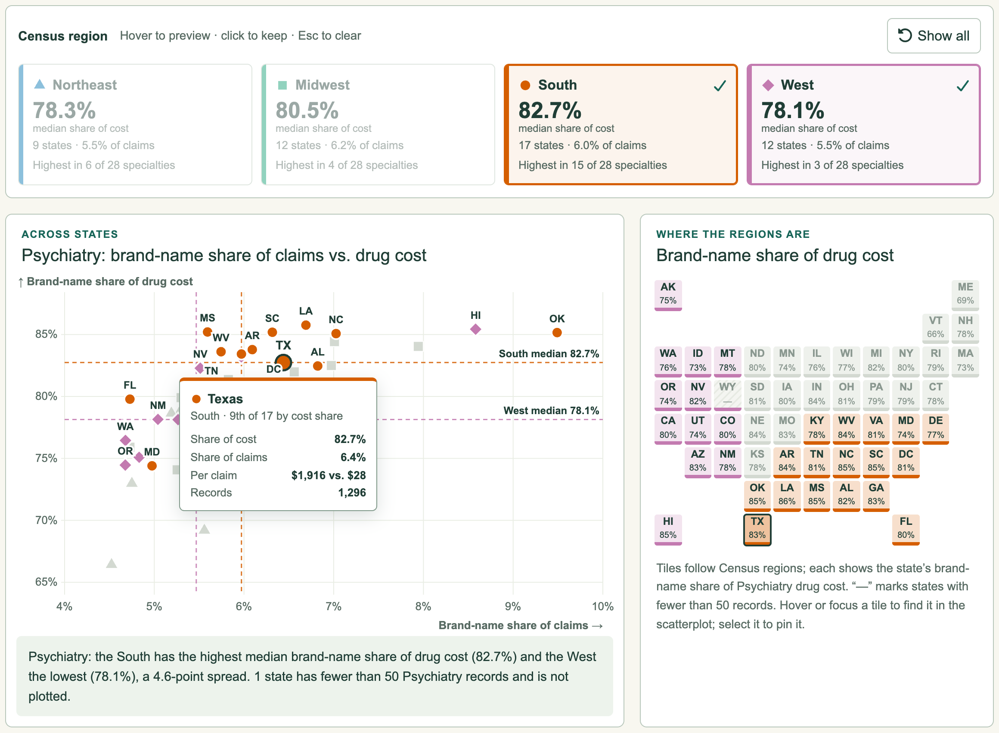
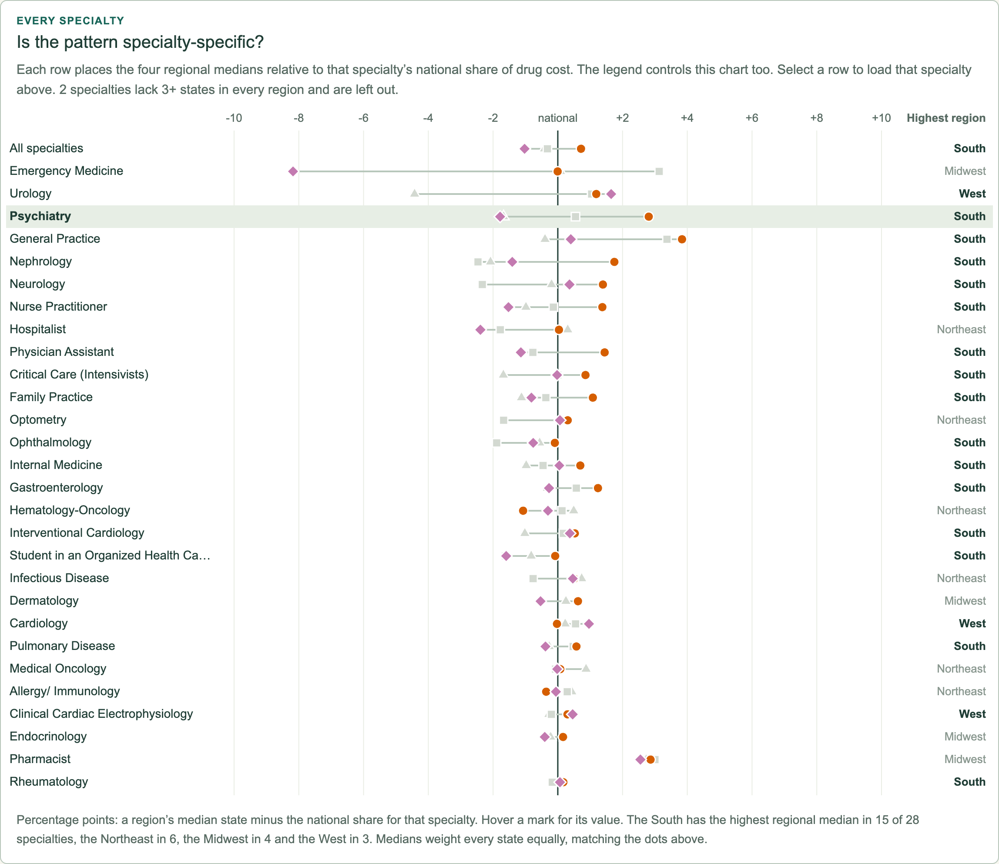

# Week 10 — Add a New Interaction: Regional lens

**Does the brand-name gap have a region?**

[Hosted Week 10 entry](https://sd7777777.github.io/data-visualization-student-starter/week-10.html) · [Week 8 original](https://sd7777777.github.io/data-visualization-student-starter/#week-8) · [Entry source](RegionalLens.tsx) · [Calculations](../../../lib/regions.ts)

Week 10 · October 2026.

## Starting point

Week 8's "Across states" chart placed every state by its brand-name share of claims (across) and of drug cost (up) for one specialty. Every dot had the same color, so it could not show whether *where* a state is matters. Week 10 copies that scatterplot into its own page and adds an **interactive color legend**.

## The interaction

Each state is colored by U.S. Census region and also gets a region shape (▲ Northeast, ■ Midwest, ● South, ◆ West), so color is never the only cue. The legend is a row of four buttons, and each one also acts as a summary:

- **Hover or focus** a region to preview it. Its states stay in color in every view, the others turn gray, and dashed crosshairs mark the region's median state.
- **Click** to keep a region highlighted. Click several to compare them, and press **Show all** or **Esc** to clear.
- Each legend entry shows that region's **median brand-name share of cost and of claims** for the current specialty, its state count, and how many specialties it leads.

The legend drives three linked views:

1. **The scatterplot**, copied from Week 8, with region medians, a hover tooltip and labels that avoid collisions.
2. **A tile map** colored by the same regions. Each tile shows the state's brand-name share of cost. Hovering a tile finds its dot in the scatterplot and opens the tooltip there, and selecting a tile pins it.
3. **Every specialty**: for 28 specialties, the four regional medians relative to that specialty's national share. Selecting a row loads that specialty.

The specialty menu (with ‹ › stepping), shareable links (`?s=Psychiatry&regions=south,west&state=TX`) and a table of all plotted states finish the page.

## What it shows

- **The South leads most often.** In 15 of 28 specialties, the South has the highest median brand-name share of drug cost. The Northeast leads in 6, the Midwest in 4 and the West in 3.
- **Psychiatry has one of the clearest splits.** The median Southern state is at 82.7% of drug cost, compared with 78.1% in the West, and the South's states sit mostly above the West's median. Their median *claim* shares are close (6.0% vs. 5.5%), so most of the difference is in cost, not in how often brand-name drugs are prescribed.
- **Across all specialties**, the regional medians are 87.2% to 88.9%, so the overall difference is small. The specialty view shows where it grows.
- **Exceptions:** the Northeast leads in Hematology-Oncology and Hospitalist medicine, and the West in Urology and Cardiology. Emergency Medicine's wide range comes mostly from suppressed records (low coverage).

These are descriptive differences between places, not explanations.

## Data and method

- Data: CMS Medicare Part D Prescribers by Provider, 2024, reusing Week 8's `drug-mix.json`. No new preprocessing was needed.
- Regions: the four U.S. Census Bureau regions, with DC in the South. Territories are not assigned.
- A state needs 50+ provider records for the specialty to be plotted, as in Week 8. A region needs 3+ plotted states for a median. Two specialties lack that in every region and are left out of the every-specialty chart.
- Regional values are **medians of state shares**: each state counts once, matching the dots. They are not pooled totals, which large states would dominate. This is why every median for Pharmacists sits above the national share, which is weighted by volume.
- Brand-name definitions, suppression handling and the gross-cost caveat are unchanged from [Week 8](../week-08/README.md#data-and-method).
- Colors are Okabe–Ito-derived (`#0072b2`, `#0a9a6e`, `#d55e00`, `#c37ab0`). They passed a palette validator for lightness, chroma, contrast on white, and protan/deutan/tritan separation. The marker shapes are a second encoding on top of color.

## Files

- `RegionalLens.tsx`: the page component. `regional-lens.css`: its styles. `app/week-10/page.tsx`: the route (`week-10.html` in the static export).
- `lib/regions.ts`: pure functions for region membership, tile grid, state points, medians, fingerprints, legend state and marker shapes.

## Verification

- `node scripts/check_regions.mjs` (part of `pnpm check`, now 11 suites). It checks that 51 states/DC map to exactly one region and one non-overlapping tile, that territories are excluded, and median arithmetic. It also checks 1,144 state points across 31 views against the threshold, that region counts partition the points, that each median is bounded and balanced, that fingerprint leaders and ordering are right, and the legend toggle and URL parsing.
- `node scripts/check_week10_browser.mjs` (Playwright, run against the GitHub Pages-style static export) covers:
  - legend hover preview and click/keyboard pinning
  - the number of lit dots and tiles per region
  - median labels
  - specialty menu, stepper and row selection
  - tile-to-dot linked hover and tooltip, tile pinning and Escape
  - shared and invalid links
  - 320/390/768/1440px layouts with no horizontal overflow and no console errors

  It writes the screenshots above.
- Week 6 and Week 8 browser regressions, TypeScript, targeted lint and the static export pass. No reader study is claimed.
