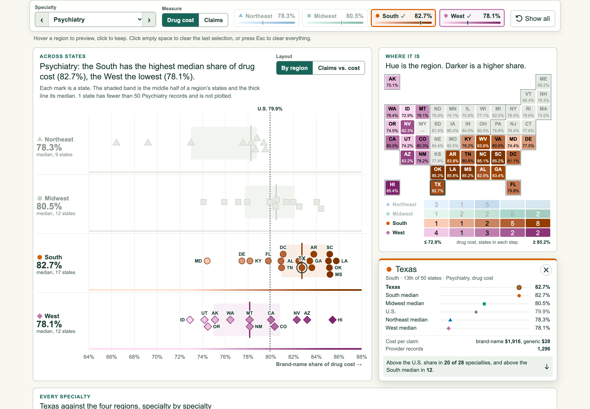

# Week 11 — Iterate your Project: Regional lens

**Does the brand-name gap have a region?**

[Hosted Week 11 entry](https://sd7777777.github.io/data-visualization-student-starter/week-11.html) · [Week 10 version](../week-10/README.md) · [Entry source](RegionalLens.tsx) · [Calculations](../../../lib/regional-lens.ts)

Week 11 · November 2026.

## Starting point

Week 10 added an interactive Census-region legend to the state scatterplot. Feedback on that page set the plan for this iteration. Week 10 stays as it was, and this version is a separate route that builds on it.

## Feedback and what changed

| Feedback | Change |
| --- | --- |
| Instructor: keep hue for the region, and use luminosity to represent the values. | The tile map now does exactly that. OKLCH lightness depends only on the value, so every region reads the same at the same value. Region outlines keep pale tiles identifiable. The legend is a region × value grid that also counts the states in each step, and hovering a cell picks out those states. |
| Peer: the scatterplot gains little from the color legend because the points cluster. | The default layout gives each region its own row, a beeswarm on one shared axis with the middle-half band and median. **Claims vs. cost** keeps the Week 10 scatterplot, now with each region's distribution along both axes, and marks glide between the two layouts. Hover snaps to the nearest mark, so a tight cluster does not need exact pointing. |
| Peer: link the single-state panel to the lower chart to compare that state with the other regions. | A pinned state opens a card that places it against all four regional medians and the U.S. It also appears on every row of the specialty chart, with its difference from the U.S. Rows can be sorted by that difference. |
| Peer: clicking away should clear a tooltip, while the pin should survive a specialty change. | Clicking empty space closes the topmost selection, first the state and then the regions. Esc still clears everything, and the card has a close button. The pin stays through specialty, measure and layout changes. |
| Peer: "Per claim $xxxx vs $yy" was unclear. | Those numbers now read "Brand-name cost per claim" and "Generic cost per claim". |

I also made changes of my own:

- A **measure switch** compares brand-name share of cost and of claims across the whole page.
- The specialty chart's axis now follows well-covered rows, so one low-coverage specialty no longer flattens the other 27. Marks beyond the axis sit at its edge with their value printed.
- Low-coverage specialties are flagged with †.
- The page has a sticky control bar, four starting points, a CSV download, and a table with labeled per-claim costs.

## What it shows

- **The South's lead is in cost more than in claims.** It has the highest median brand-name share of drug cost in 15 of 28 specialties, but the highest median share of claims in only 8. The Northeast leads on claims, in 9.
- **Georgia stands out.** It is above the U.S. brand-name share of cost in 26 of 28 specialties and above the South's own median in 25.
- **Urology splits the other way.** The Northeast's median is 84.1% of drug cost, compared with 89.6% to 90.2% in the other regions.
- **Psychiatry** still shows one of the clearest differences: South 82.7%, West 78.1%.

These are descriptive differences between places. They do not explain why prescribing differs or show whether a generic was available or appropriate.

## Data and method

- Data: CMS Medicare Part D Prescribers by Provider, 2024, reusing `drug-mix.json`. No new preprocessing.
- Regions, thresholds and brand-name definitions are unchanged from [Week 10](../week-10/README.md#data-and-method): four Census regions, 50+ provider records to plot a state, and 3+ plotted states for a regional median.
- Regional values are medians of state shares, so each state counts once. The U.S. figure pools all claims, so the two are not the same kind of number.
- **Color.** A region's hue comes from its Week 10 color. Lightness runs from 0.93 to 0.42 in OKLCH across the 5th to 95th percentile of plotted states in the current view, and values outside that range take the end color. Chroma is reduced only as far as the sRGB gamut requires. Tile text is black or white, whichever is more legible, and always reaches 4.5:1.
- **Box statistics** use R-7 quantiles. The median on each strip equals the Week 10 regional median whenever a region has 3+ plotted states.
- **Beeswarm:** marks keep their exact value on the axis and move off the center line only to avoid overlap.
- Comparing a state with the regions is limited to specialties where it has 50+ records. Rows without enough records show "—" and are not counted.

## Files

- `RegionalLens.tsx`: page state, controls and layout. `RegionChart.tsx`: the two-layout chart. `ToneMap.tsx`: tile map and legend grid. `StateCard.tsx`: the pinned state. `SpecialtyChart.tsx`: every specialty. `shared.tsx`, `regional-lens.css`: helpers and styles. `app/week-11/page.tsx`: the route (`week-11.html` in the static export).
- `lib/regional-lens.ts`: pure functions for tones, the value scale, quantiles, beeswarm, state comparison, sorting, clearing and link parsing.

## Verification

- `node scripts/check_regional_lens.mjs` (part of `pnpm check`, now 12 suites) checks:
  - 204 tones for lightness, hue and contrast
  - 62 views (31 specialty options × 2 measures), for state counts, step partition and box statistics
  - 242 regional beeswarms for overlap
  - 102 state comparisons against an independent recalculation
  - the cost and claims tallies quoted above
- `node scripts/check_week11_browser.mjs` (Playwright, run on a GitHub Pages-style static export) covers each feedback item above, the layout morph with motion on, sorting, keyboard rows, CSV contents, shared and invalid links, and 320/390/768/1024/1440px layouts. It writes the screenshots used here.
- Week 6, Week 8 and Week 10 browser regressions, TypeScript, targeted lint and the static export pass. No reader study is claimed.
