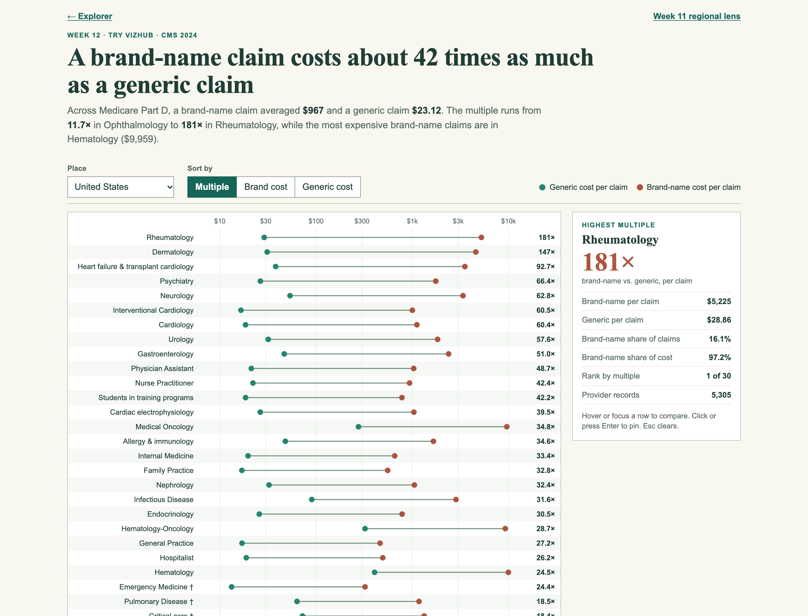

# Week 12 — Try VizHub: Brand vs. generic cost per claim

**How many times more does a brand-name claim cost than a generic one?**

[Hosted Week 12 entry](https://sd7777777.github.io/data-visualization-student-starter/week-12.html) · [Entry source](CostRatio.tsx) · [Calculations](../../../lib/cost-ratio.ts)

Week 12 · November 2026.

## How it was made

I gave VizHub a CSV extract of this project's data: state × specialty for the 50 states and DC, with Census regions. It is an export of `drug-mix.json`, so it is the same CMS source as Weeks 8–11. Then I ran the three AI workflows in order:

1. **Analyze Data** produced five options. Four rendered. I kept the log-scale bubble chart of claims and cost per claim.
2. **Generate Ideas** proposed 20 dataset-specific visualization ideas.
3. **Generate Many Prototypes** built those 20 ideas, with up to five model variations each. Some variations failed at runtime, so I compared the working ones.

I chose **Brand to Generic Cost per Claim Ratio**, Option 3. Earlier weeks show this multiple only as a table column or tooltip. Here it is the main thing the chart encodes, and it turns a share of spending into a price comparison that is easy to picture.

## What changed from the prototype

| Prototype | This version |
| --- | --- |
| Computed brand-name as `total − generic`, counting suppressed generics as brand-name. | Uses covered totals through the existing `mixRow`. Most specialties barely move, but Emergency Medicine goes from 20.6× to about 24×. |
| Drew a “1× equal” line at $1 per claim. A 1:1 ratio is not a position on a dollar axis, so it was misleading. | Removed. The multiple is printed for every row. |
| Footnote always read “0 rows excluded”, because suppression happens before the CSV. | Replaced with a coverage flag (†) on specialties where under 95% of claims have a generic split. |
| Clipped long specialty names, overlapped the footnote with the last rows, and printed the top three multiples twice. | Shortened labels (full names in the card and table), a stacked layout on narrow screens, and one multiple per row. |
| Hover-only tooltip. | Hover, keyboard focus and click-to-pin all drive a detail card. A table gives every value without the chart. |
| United States only, one order. | Any state or DC on one fixed axis, three sort orders with animated reordering, and shareable links. |

## What it shows

- Nationally, a brand-name claim averaged $967 and a generic claim $23.12, about 42 times as much.
- The multiple runs from 11.7× in Ophthalmology to 181× in Rheumatology.
- The biggest multiples are not where brand-name claims cost the most. Hematology has the most expensive brand-name claims at $9,959, but its multiple is lower because its generic claims are also expensive.

## Limits

These are averages over different drugs, not a brand-name drug against its own generic. Brand-name claims include drugs with no generic, and a claim can be a 30-day or 90-day fill. A high multiple can come from cheap generics as much as from expensive brand-name drugs. Costs are gross of manufacturer rebates, which mainly reduce brand-name prices. Nothing here shows whether a generic was available or appropriate.

## Data and method

- Data: CMS Medicare Part D Prescribers by Provider, 2024, reusing `drug-mix.json`. No new preprocessing.
- `brand per claim = (covered cost − generic cost) / (covered claims − generic claims)`, and `generic per claim = generic cost / generic claims`. Both pool claims rather than averaging provider or state rates.
- Brand-name includes CMS's small “other” category, as in Week 8.
- A state's specialty needs 50+ provider records. The United States view pools all records, including territories, so its figures differ slightly from a 50-state-plus-DC sum: Rheumatology is 181× here and 179.8× across the states and DC.
- The axis is logarithmic and fixed across places, so switching geography moves the marks and not the scale.

## Checks

`scripts/check_cost_ratio.mjs` (in `pnpm check`) recomputes every geography-specialty row from the raw tuples and confirms the prototype's formula differs where coverage is low. `scripts/check_week12_browser.mjs` covers sorting, geography, hover, pinning, keyboard use, the table, shared links and five screen widths. No reader study is claimed.
