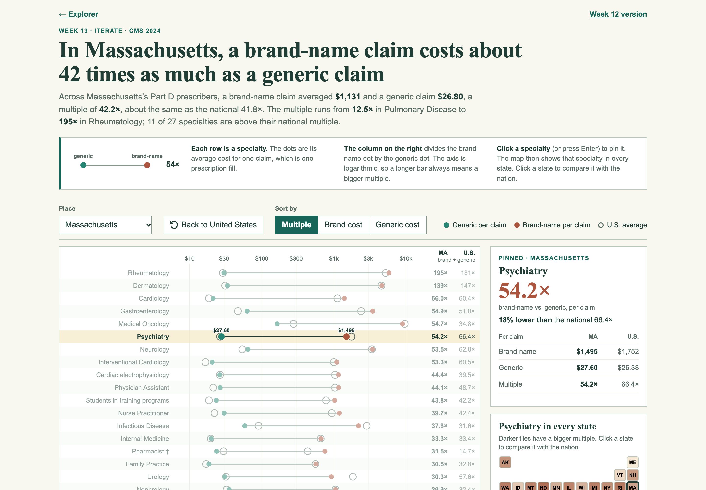

# Week 13 — Iterate your Project: Brand vs. generic, state vs. nation

**Is my state's brand-name premium high or low, and where is it highest for a given specialty?**

[Hosted Week 13 entry](https://sd7777777.github.io/data-visualization-student-starter/week-13.html) · [Entry source](StateCompare.tsx) · [Calculations](../../../lib/state-compare.ts)

Week 13 · November 2026.

## Why this iteration

I ran a first-time-user walkthrough of the Week 12 page. It surfaced these problems:

1. **The title did not follow the place.** After switching to Massachusetts, it still said "about 42 times", which read like a mistake. (By coincidence, Massachusetts is 42.2×, but most states differ.)
2. **A state view had no reference point.** Massachusetts showed 54.9× for Gastroenterology, with no way to tell whether that is high or low.
3. **Reading a row took guesswork.** The multiple column had no header, the log scale was explained only in the axis title, "claim" was never defined, and pinning was explained only in small print at the bottom of the card.
4. **Pinned views were hard to scan.** Non-focused rows faded to 35% opacity, and a scroll could leave a stale hover in the card.

## What changed

| Week 12 | Week 13 |
| --- | --- |
| Title always used the national figure. | Title and summary follow the place, and a state summary compares itself with the nation ("about the same as the national 41.8×; 11 of 27 specialties are above their national multiple"). |
| One place at a time. | When a state is chosen, every row keeps the national averages as hollow rings, a U.S. column sits beside the state's multiple, and the card shows state vs. U.S. side by side with a verdict ("18% lower than the national 66.4×"). |
| No geographic view. | A state tile map shows the focused specialty in all 50 states and DC. It follows hover and pinning on the chart. Clicking a tile switches the place and keeps the pinned specialty, and clicking the selected tile returns to the U.S. The ramp marks the U.S. value, and tiles with low generic coverage carry †. |
| Instructions in small print. | A three-part "how to read" guide under the title, a "Brand ÷ generic" column header and a Back to United States button. |
| Dimmed rows at 35%; hover could stick after scrolling. | Dimmed rows at 50%; scrolling clears a stale hover. |

## What it shows

- Nationally a brand-name claim costs 41.8× a generic claim. By state, the multiple ranges from 35.0× (New York) to 51.9× (Mississippi).
- Georgia's multiple is above the national one in 26 of its 28 specialties, Michigan's in only 4 of 28.
- Rheumatology has the highest multiple everywhere, but it still varies from 132× in Minnesota to 235× in Connecticut.

## Design notes

- Map colour is a single-hue sand-to-rust ramp on a log scale, so equal colour steps are equal ratios, matching the chart's log axis. Tile labels pick black or white for contrast; every point on the ramp clears 4.5:1, which the check verifies.
- The colour domain uses states with good generic coverage, trimmed to within 4× of the median, and clamps the rest, so one outlier cannot wash out the map. Virginia pharmacists (0.3×, with about 1% of claims generic) are the case that needs this. The ramp labels show ≤/≥ when a value is clamped.
- Region hue from Weeks 10–11 is not used here. The map answers "where is it high?", which is a sequential question.

## Limits

These are averages over different drugs, not a brand-name drug against its own generic. A state's difference from the nation can reflect its mix of patients and drugs, not prices alone. Costs are gross of rebates. A state specialty needs 50+ provider records, and the United States view pools all records, including territories.

## Checks

`scripts/check_state_compare.mjs` (in `pnpm check`, now 14 suites) covers several things. National rows match Week 12. All 1,530 specialty-state cells match each state's own Week 12 row. Ranking, comparison wording and titles are checked, along with tile-text contrast across the ramp and the outlier-resistant colour domain. `scripts/check_week13_browser.mjs` covers the title following the place, rings and U.S. column, the reset button, the pin-to-map link, tile clicks and keyboard use, the scroll fix, the table's U.S. column, and six layouts from 320 to 1440 px.

The user test was a structured walkthrough by an AI assistant (Claude) acting as a first-time student user. It was not a study with real participants.
